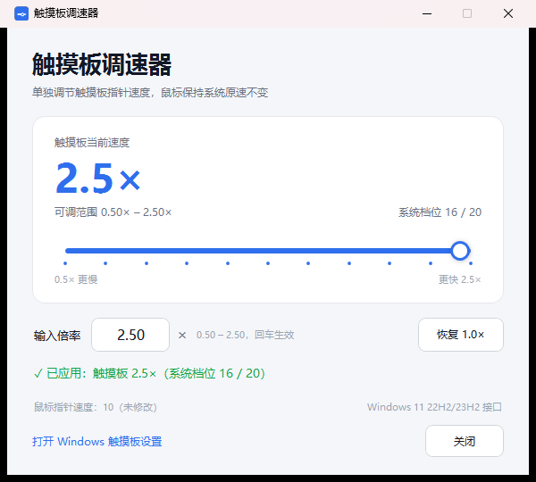

# Touchpad Tuner · 触摸板调速器

[](LICENSE)
[](#requirements)
[](#how-it-works)

> **Adjust your Windows Precision Touchpad cursor speed independently — without touching the mouse.**
> A tiny Windows 11 utility with a slider + numeric multiplier (0.50× – 2.50×). No drivers, no admin rights, no background service.
>
> **单独调节 Windows 精密触摸板的指针速度，鼠标指针速度保持不变。**
> 滑块 + 数字倍率（0.50× – 2.50×），无需驱动、无需管理员权限、无后台服务。

[English](#english) · [中文](#中文)


| 1.0×（默认） | 2.5×（最快） |
| --- | --- |
|  |  |

---

## English

### Features

- **Touchpad-only:** changes the Precision Touchpad cursor speed; the mouse pointer speed is left completely untouched (the footer shows the current mouse speed for confirmation).
- **Slider + numeric input:** pick a multiplier from `0.50×` to `2.50×`, or type it and press Enter. Applies instantly.
- **Easy reset:** one click on **Reset 1.0×**.
- **Stays in sync:** if you change the touchpad speed in Windows Settings, the tool updates itself automatically.
- **Nothing invasive:** no kernel driver, no admin rights, no background service, no autostart entry, no network access. Closing the window keeps the last applied setting.
- **Small and transparent:** a 14 KB launcher plus a readable PowerShell/WPF script. Source included.

### Why not just use Windows Settings?

Windows 11 does expose a touchpad speed slider (Settings → Bluetooth & devices → Touchpad → Cursor speed), but it is buried in Settings, only has 10 coarse steps, and gives no numeric sense of "how much faster". This tool exposes the **same** Precision Touchpad setting with:

- a quick-access desktop app;
- a finer, numeric multiplier from 0.50× to 2.50×;
- an explicit guarantee (and live indicator) that the **mouse** speed is not modified.

### Requirements

- Windows 11 (22H2 / 23H2 / 24H2 or newer) with a **Precision Touchpad** (built-in laptop touchpad, or a trackpad that Windows exposes as `HID-compliant touch pad`).
- Tested on: Windows 11 23H2, Apple Magic Trackpad 2 (USB) + Logitech mouse.

> If Windows did not expose the Precision Touchpad interface, the app tells you so instead of silently doing nothing.

### Install

1. Open the [Releases](../../releases) page and download `TouchpadTuner-v1.0.0-windows.zip`.
2. Extract the zip anywhere (e.g. `Desktop\TouchpadTuner`).
3. Keep the three files together: `TouchpadTuner.exe`, `TouchpadTuner.ps1`, `app.ico`.
4. Double-click `TouchpadTuner.exe`.

No installer, no dependencies — the UI is started with the Windows built-in PowerShell.

### Usage

- Drag the slider, or type a multiplier such as `1.25` into the input box and press Enter.
- Current multiplier and Windows system level (1–20) are shown in the card.
- The footer always shows the mouse pointer speed (should stay at its original value).
- **Reset 1.0×** restores the default touchpad speed.

| Multiplier | 0.50× | 0.625× | 0.75× | 0.875× | **1.00×** | 1.25× | 1.50× | 1.75× | 2.00× | 2.25× | 2.50× |
| --- | --- | --- | --- | --- | --- | --- | --- | --- | --- | --- | --- |
| Windows level | 6 | 7 | 8 | 9 | **10** | 11 | 12 | 13 | 14 | 15 | 16 |

Windows maps pointer-speed levels 1–20 to a non-linear curve; level 10 is the default (1.0×). The Precision Touchpad cursor speed uses the same curve, so the table above is how each multiplier maps to the system setting.

### How it works

The tool calls the Windows Precision Touchpad settings interface:

```c
SystemParametersInfo(SPI_GETTOUCHPADPARAMETERS, ...);  // read current touchpad settings
SystemParametersInfo(SPI_SETTOUCHPADPARAMETERS, ...);  // apply the new cursor speed
```

and persists the setting to:

```
HKEY_CURRENT_USER\Software\Microsoft\Windows\CurrentVersion\PrecisionTouchPad\CursorSpeed
```

It never writes to the mouse settings (`HKCU\Control Panel\Mouse`).

Implementation note: the public `TOUCHPAD_PARAMETERS` structure only exists in the Windows 11 24H2 SDK, and Windows 11 22H2/23H2 uses an earlier 24-byte layout with `versionNumber = 0`. The app detects the layout automatically:

| Windows build | `uiParam` (struct size) | Cursor speed offset |
| --- | --- | --- |
| 22H2 / 23H2 | 24 | 16 |
| 24H2+ (`V1`) | 44 | 24 |
| 24H2+ (`V2`) | 48 | 24 |

### FAQ

- **The window takes a moment to appear.** The UI runs on PowerShell + WPF; the first launch takes about 1–2 seconds.
- **Nothing happens when I double-click the exe.** Make sure all three files are in the same folder. Some security software may block PowerShell scripts; allow the folder or review the source.
- **Changing the slider does not change the touchpad speed.** Check that the status line says "applied". If your touchpad is a plain HID mouse (not a Precision Touchpad), Windows does not expose this interface.
- **How do I uninstall it?** Delete the folder. Nothing is installed, registered or auto-started. Reset the speed to 1.0× first if you want the default behavior back.

### Build

```powershell
powershell -ExecutionPolicy Bypass -File .\build-launcher.ps1
```

Uses the C# compiler shipped with the .NET Framework — no Visual Studio or .NET SDK required.

### License

This project is licensed under the **GNU General Public License v3.0 only** (`GPL-3.0-only`). See [LICENSE](LICENSE).

---

## 中文

### 功能特点

- **只改触摸板**：调节精密触摸板的光标速度，鼠标指针速度完全不动（窗口底部实时显示鼠标速度，方便确认）。
- **滑块 + 数字输入**：`0.50×` 到 `2.50×`，可拖滑块，也可输入倍率后回车，立即生效。
- **一键恢复**：点「恢复 1.0×」回到默认速度。
- **自动同步**：在 Windows 设置里调整触摸板速度后，工具会自动更新显示。
- **无侵入**：不装驱动、不需要管理员权限、无后台服务、不写开机启动项、不联网。关闭窗口不会改变已应用的设置。
- **小而透明**：14 KB 启动器 + 可阅读的 PowerShell/WPF 脚本，源码全部开源。

### 为什么不直接用 Windows 设置？

Windows 11 自带「设置 → 蓝牙和其他设备 → 触摸板 → 光标速度」，但它藏得较深、只有 10 个较粗的档位，也没有直观的倍率概念。本工具使用的是**同一个**精密触摸板设置项，但提供：

- 桌面快捷方式，随开随调；
- 更细的 0.50×–2.50× 数字倍率；
- 明确的「鼠标速度未被修改」提示。

### 系统要求

- Windows 11（22H2 / 23H2 / 24H2 及以上），连接**精密触摸板**（笔记本自带触摸板，或被 Windows 识别为「HID-compliant touch pad / 符合 HID 标准的触摸板」的外接触控板）。
- 已实测：Windows 11 23H2 + Apple Magic Trackpad 2（USB）+ 罗技鼠标。

> 如果系统没有暴露精密触摸板接口，程序会明确提示，而不是静默无效。

### 安装

1. 打开 [Releases](../../releases) 页面，下载 `TouchpadTuner-v1.0.0-windows.zip`。
2. 解压到任意文件夹（例如 `桌面\TouchpadTuner`）。
3. 保持三个文件在同一目录：`TouchpadTuner.exe`、`TouchpadTuner.ps1`、`app.ico`。
4. 双击 `TouchpadTuner.exe` 即可。

无需安装，无运行库依赖——界面由 Windows 自带的 PowerShell 启动。

### 使用

- 拖动滑块，或在「输入倍率」中输入如 `1.25` 后按回车。
- 卡片中显示当前倍率和 Windows 系统档位（1–20）。
- 底部始终显示鼠标指针速度（保持原值）。
- 点「恢复 1.0×」恢复默认触摸板速度。

| 界面倍率 | 0.50× | 0.625× | 0.75× | 0.875× | **1.00×** | 1.25× | 1.50× | 1.75× | 2.00× | 2.25× | 2.50× |
| --- | --- | --- | --- | --- | --- | --- | --- | --- | --- | --- | --- |
| 系统档位 | 6 | 7 | 8 | 9 | **10** | 11 | 12 | 13 | 14 | 15 | 16 |

Windows 的指针速度档位 1–20 是一条非线性曲线，档位 10 为默认值（1.0×）；精密触摸板光标速度使用同一套曲线，因此上表就是倍率与系统档位的对应关系。

### 原理

工具调用 Windows 的精密触摸板设置接口：

```c
SystemParametersInfo(SPI_GETTOUCHPADPARAMETERS, ...);  // 读取当前触摸板设置
SystemParametersInfo(SPI_SETTOUCHPADPARAMETERS, ...);  // 应用新的光标速度
```

并写入当前用户设置：

```
HKEY_CURRENT_USER\Software\Microsoft\Windows\CurrentVersion\PrecisionTouchPad\CursorSpeed
```

全程**不会**修改鼠标设置（`HKCU\Control Panel\Mouse`）。

实现细节：公开的 `TOUCHPAD_PARAMETERS` 结构只存在于 Windows 11 24H2 SDK 中，而 22H2/23H2 使用更早的 24 字节布局（`versionNumber = 0`）。程序会自动探测：

| Windows 版本 | `uiParam`（结构大小） | 光标速度字段偏移 |
| --- | --- | --- |
| 22H2 / 23H2 | 24 | 16 |
| 24H2+（`V1`） | 44 | 24 |
| 24H2+（`V2`） | 48 | 24 |

### 常见问题

- **窗口出现得有点慢？** 界面由 PowerShell + WPF 启动，首次启动约 1–2 秒。
- **双击 exe 没反应？** 确认三个文件在同一文件夹；部分安全软件会拦截 PowerShell 脚本，可放行该目录或查看源码。
- **拖动滑块后触摸板速度没变？** 看状态栏是否显示「已应用」；如果触摸板是普通 HID 鼠标（非精密触摸板），系统不会提供该接口。
- **如何卸载？** 删除文件夹即可。程序不安装、不注册、不开机启动；想恢复默认速度，先点「恢复 1.0×」。

### 构建

```powershell
powershell -ExecutionPolicy Bypass -File .\build-launcher.ps1
```

使用 .NET Framework 自带的 C# 编译器，无需 Visual Studio 或 .NET SDK。

### 许可证

本项目采用 **GNU General Public License v3.0 only**（`GPL-3.0-only`）开源，详见 [LICENSE](LICENSE)。
