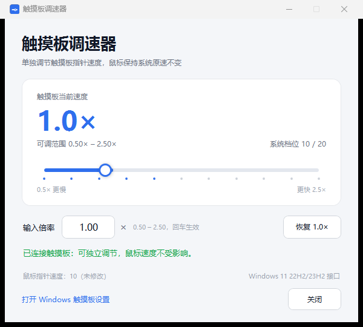

# Touchpad Tuner · 触摸板调速器

[](LICENSE)
[](#requirements)
[](#how-it-works)

> **Tune your Windows Precision Touchpad cursor speed independently, and get macOS-style three-finger dragging.**
> A tiny Windows 11 utility: slider + numeric multiplier (0.50× – 2.50×), three-finger drag, system tray background mode, no drivers, no admin rights.
>
> **单独调节 Windows 精密触摸板指针速度，并解锁 macOS 风格的三指拖曳。**
> 滑块 + 数字倍率（0.50× – 2.50×）、三指拖曳、托盘后台常驻；无需驱动、无需管理员权限。

[English](#english) · [中文](#中文)



---

## English

### Features

- **Touchpad-only speed control:** changes the Precision Touchpad cursor speed; the mouse pointer speed is left completely untouched (the footer shows the current mouse speed, and it never changes).
- **Slider + numeric input:** pick a multiplier from `0.50×` to `2.50×`, or type it and press Enter. Applies instantly.
- **macOS-style three-finger drag:** hold three fingers on the touchpad and move them to drag windows or select text. A sensitivity slider controls the drag speed.
- **Runs in the background:** closing the main window keeps the program alive in the system tray, so three-finger drag keeps working. Double-click the tray icon to reopen the window. The tray menu also lets you **exit the UI while keeping three-finger drag running** (no window, no tray icon — relaunch the app from the desktop shortcut to get the UI back).
- **Start with Windows (optional):** one checkbox to auto-start the tool in the background at login, so three-finger drag is always available.
- **One-click gesture migration:** Windows uses three-finger swipes for app switching / Task View / Show Desktop. The tool can move those actions to four-finger gestures (three-finger swipe → *Nothing*, four-finger swipe → *Switch apps and show desktop*) so the three-finger drag does not conflict.
- **Nothing invasive:** no kernel driver, no admin rights, no background service, no network access.
- **Small and transparent:** a launcher exe + a readable PowerShell/WPF script + a small C# helper; full source included.

### Requirements

- Windows 11 (22H2 / 23H2 / 24H2 or newer) with a **Precision Touchpad** (built-in laptop touchpad, or a trackpad Windows exposes as `HID-compliant touch pad`).
- Tested on: Windows 11 23H2, **Apple Magic Trackpad 2** (USB) + Logitech USB mouse. The trackpad reports up to 5 simultaneous contacts; the drag engine uses 3.

### Install

1. Open the [Releases](../../releases) page and download `TouchpadTuner-v1.1.1-windows.zip`.
2. Extract the zip anywhere (e.g. `Desktop\TouchpadTuner`).
3. Keep these files together: `TouchpadTuner.exe`, `TouchpadTuner.ps1`, `TouchpadTuner.Helper.dll`, `app.ico`.
4. Double-click `TouchpadTuner.exe`.

No installer, no dependencies — the UI is started with the Windows built-in PowerShell.

### Usage

#### Cursor speed

- Drag the slider, or type a multiplier such as `1.25` into the input box and press Enter.
- Current multiplier and Windows system level (1–20) are shown in the card.
- The footer always shows the mouse pointer speed (should stay at its original value).
- **Reset 1.0×** restores the default touchpad speed.

| Multiplier | 0.50× | 0.625× | 0.75× | 0.875× | **1.00×** | 1.25× | 1.50× | 1.75× | 2.00× | 2.25× | 2.50× |
| --- | --- | --- | --- | --- | --- | --- | --- | --- | --- | --- | --- |
| Windows level | 6 | 7 | 8 | 9 | **10** | 11 | 12 | 13 | 14 | 15 | 16 |

#### Three-finger drag

1. Turn on the **三指拖曳 / Three-finger drag** switch.
2. First time only: click **把 Windows 三指手势迁移到四指 / Move Windows three-finger gestures to four fingers** so Windows stops using three-finger swipes for app switching. (Requires Windows Settings to open once; the tool changes the settings automatically and restores nothing on exit — you can change them back in Settings at any time.)
3. Hold **three fingers** on the touchpad, then move them: a left-button drag is synthesized (drag windows, select text, move icons).
4. Lift the fingers to drop. The drag-speed slider adjusts the cursor movement.
5. Close the window if you like — the app stays in the tray and three-finger drag keeps working. Right-click the tray icon for **打开 / 三指拖曳 / 退出**.

#### Background & auto-start

- The window close button hides the app to the system tray; the tool keeps running.
- Check **开机自动启动 / Start with Windows** to launch the tool in the background when you log in (stored in `HKCU\Software\Microsoft\Windows\CurrentVersion\Run`; uncheck to remove).

### How it works

- **Touchpad speed:** calls the Windows Precision Touchpad settings interface:

```c
SystemParametersInfo(SPI_GETTOUCHPADPARAMETERS, ...);  // read current touchpad settings
SystemParametersInfo(SPI_SETTOUCHPADPARAMETERS, ...);  // apply the new cursor speed
```

and persists the setting to:

```
HKEY_CURRENT_USER\Software\Microsoft\Windows\CurrentVersion\PrecisionTouchPad\CursorSpeed
```

It never writes to the mouse settings (`HKCU\Control Panel\Mouse`).

Implementation note: the public `TOUCHPAD_PARAMETERS` structure only exists in the Windows 11 24H2 SDK, and Windows 11 22H2/23H2 uses an earlier 24-byte layout with `versionNumber = 0`. The app detects the layout automatically:

| Windows build | `uiParam` (struct size) | Cursor speed offset |
| --- | --- | --- |
| 22H2 / 23H2 | 24 | 16 |
| 24H2+ (`V1`) | 44 | 24 |
| 24H2+ (`V2`) | 48 | 24 |

- **Three-finger drag:** registers Raw Input for the touchpad HID collection (usage page `0x0D`, usage `0x05`) and decodes its HID reports (Contact Count / Contact ID / X / Y via `HidP_GetUsageValue`, supporting up to 5 contacts). A small state machine recognizes a three-finger drag and synthesizes the mouse movement and left-button hold/release with `SendInput` (absolute positioning, so the mouse pointer acceleration curve does not distort the drag). The regular one-finger touchpad mousing is untouched.
- **Gesture migration:** uses Windows UI Automation to open *Settings → Bluetooth & devices → Touchpad* and set the three-finger swipe to *Nothing* and the four-finger swipe to *Switch apps and show desktop*.

### FAQ

- **The window takes a moment to appear.** The UI runs on PowerShell + WPF; the first launch takes about 1–2 seconds.
- **Nothing happens when I double-click the exe.** Make sure all four files are in the same folder. Some security software may block PowerShell scripts; allow the folder or review the source.
- **Three-finger drag does not start.** Make sure the switch is on and that the touchpad is a Precision Touchpad. Also click the gesture-migration button once, otherwise Windows' own three-finger gestures may intercept the swipes.
- **Does three-finger drag work after closing the window?** Yes — closing hides the app to the system tray. To exit the UI while keeping the drag running, right-click the tray icon → **退出界面（三指拖曳继续后台运行）**; relaunch the shortcut to return. Use **完全退出（停止三指拖曳）** to fully stop the tool.
- **Why can't it keep working after a full exit?** Three-finger drag must read touchpad input and synthesize mouse events, which requires a small background process. "Completely exit" terminates it; use the background exit option or the auto-start checkbox if you want it always available.
- **How do I uninstall it?** Right-click the tray icon → 退出; delete the folder and the desktop shortcut. Nothing is installed, registered or auto-started (uncheck auto-start first if you enabled it).

### Build

```powershell
powershell -ExecutionPolicy Bypass -File .\build-launcher.ps1
```

Builds `TouchpadTuner.Helper.dll` (C# helper) and `TouchpadTuner.exe` (launcher) with the C# compiler shipped with the .NET Framework — no Visual Studio or .NET SDK required.

### License

This project is licensed under the **GNU General Public License v3.0 only** (`GPL-3.0-only`). See [LICENSE](LICENSE).

---

## 中文

### 功能特点

- **只改触摸板速度**：调节精密触摸板的光标速度，鼠标指针速度完全不动（窗口底部实时显示鼠标速度，始终不变）。
- **滑块 + 数字倍率**：`0.50×` 到 `2.50×`，可拖滑块，也可输入倍率后回车，立即生效。
- **macOS 风格三指拖曳**：三根手指按住触摸板并移动，即可拖动窗口、选中文字；拖曳速度可用滑块调节。
- **后台常驻**：关闭主窗口不会退出程序，而是隐藏到系统托盘，三指拖曳继续可用；双击托盘图标重新打开窗口。托盘菜单还支持「**退出界面（三指拖曳继续后台运行）**」——界面和托盘图标都消失，但拖曳功能保留；双击桌面快捷方式即可恢复界面。
- **开机自启（可选）**：勾选「开机自动启动」后，登录 Windows 时自动在后台启动，三指拖曳随时可用。
- **一键手势迁移**：Windows 默认用三指手势切换应用 / 任务视图 / 显示桌面。工具可把这三指动作移到四指（三指手势 → 无，四指手势 → 切换应用并显示桌面），避免和三指拖曳冲突。
- **无侵入**：不装驱动、不需要管理员权限、无后台服务、不联网。
- **小而透明**：启动器 exe + 可阅读的 PowerShell/WPF 主程序 + 小型 C# 辅助 DLL，源码全部开源。

### 系统要求

- Windows 11（22H2 / 23H2 / 24H2 及以上），连接**精密触摸板**（笔记本自带触摸板，或被 Windows 识别为「HID-compliant touch pad / 符合 HID 标准的触摸板」的外接触控板）。
- 已实测：Windows 11 23H2 + **Apple Magic Trackpad 2**（USB）+ 罗技 USB 鼠标。该触摸板最多支持 5 个触点同时识别，拖曳引擎使用 3 指。

### 安装

1. 打开 [Releases](../../releases) 页面，下载 `TouchpadTuner-v1.1.1-windows.zip`。
2. 解压到任意文件夹（例如 `桌面\TouchpadTuner`）。
3. 保持这些文件在同一目录：`TouchpadTuner.exe`、`TouchpadTuner.ps1`、`TouchpadTuner.Helper.dll`、`app.ico`。
4. 双击 `TouchpadTuner.exe` 即可。

无需安装，无运行库依赖——界面由 Windows 自带的 PowerShell 启动。

### 使用

#### 调节光标速度

- 拖动滑块，或在「输入倍率」中输入如 `1.25` 后按回车。
- 卡片中显示当前倍率和 Windows 系统档位（1–20）。
- 底部始终显示鼠标指针速度（保持原值）。
- 点「恢复 1.0×」恢复默认触摸板速度。

| 界面倍率 | 0.50× | 0.625× | 0.75× | 0.875× | **1.00×** | 1.25× | 1.50× | 1.75× | 2.00× | 2.25× | 2.50× |
| --- | --- | --- | --- | --- | --- | --- | --- | --- | --- | --- | --- |
| 系统档位 | 6 | 7 | 8 | 9 | **10** | 11 | 12 | 13 | 14 | 15 | 16 |

#### 三指拖曳

1. 打开「三指拖曳」开关。
2. 首次使用先点「**一键把 Windows 三指手势迁移到四指**」（会打开一次 Windows 设置，工具自动改好：三指 → 无，四指 → 切换应用并显示桌面；之后也可以在设置里手动改回）。
3. **三根手指**按在触摸板上并一起移动：工具会模拟按住左键拖动（可拖动窗口、选中文字、移动图标）。
4. 抬起手指即松开；「拖曳速度」滑块可调节拖动时的指针速度。
5. 关掉窗口也没关系：程序会留在系统托盘，三指拖曳继续工作。右键托盘图标有「打开 / 三指拖曳 / 退出」。

#### 后台与开机自启

- 点窗口关闭按钮 = 隐藏到托盘，程序继续运行。
- 勾选「开机自动启动（后台运行）」后，登录 Windows 时会自动后台启动；取消勾选即移除（写入 `HKCU\Software\Microsoft\Windows\CurrentVersion\Run`）。

### 原理

- **触摸板调速**：调用 Windows 精密触摸板设置接口：

```c
SystemParametersInfo(SPI_GETTOUCHPADPARAMETERS, ...);  // 读取当前触摸板设置
SystemParametersInfo(SPI_SETTOUCHPADPARAMETERS, ...);  // 应用新的光标速度
```

并写入当前用户设置：

```
HKEY_CURRENT_USER\Software\Microsoft\Windows\CurrentVersion\PrecisionTouchPad\CursorSpeed
```

全程**不会**修改鼠标设置（`HKCU\Control Panel\Mouse`）。

实现细节：公开的 `TOUCHPAD_PARAMETERS` 结构只存在于 Windows 11 24H2 SDK 中，而 22H2/23H2 使用更早的 24 字节布局（`versionNumber = 0`）。程序会自动探测：

| Windows 版本 | `uiParam`（结构大小） | 光标速度字段偏移 |
| --- | --- | --- |
| 22H2 / 23H2 | 24 | 16 |
| 24H2+（`V1`） | 44 | 24 |
| 24H2+（`V2`） | 48 | 24 |

- **三指拖曳**：通过 Raw Input 注册触摸板的 HID 集合（usage page `0x0D`、usage `0x05`），解析其输入报告（Contact Count / Contact ID / X / Y，使用 `HidP_GetUsageValue`，最多支持 5 个触点）；状态机识别出三指拖曳后，用 `SendInput` 绝对定位移动指针并模拟左键按下/抬起（不经过指针加速度曲线，拖动手感更稳定）。单指正常移动完全不受影响。
- **手势迁移**：通过 Windows UI Automation 打开「设置 → 蓝牙和其他设备 → 触摸板」，把三指轻扫设为「无」、四指轻扫设为「切换应用并显示桌面」。

### 常见问题

- **窗口出现得有点慢？** 界面由 PowerShell + WPF 启动，首次启动约 1–2 秒。
- **双击 exe 没反应？** 确认四个文件在同一文件夹；部分安全软件会拦截 PowerShell 脚本，可放行该目录或查看源码。
- **三指拖曳不触发？** 确认开关已打开、触摸板是精密触摸板；并点一次「一键迁移手势」，否则 Windows 自带的三指手势会抢走滑动。
- **关掉窗口后三指拖曳还能用吗？** 可以——关闭只是隐藏到托盘。想「退出界面但保留拖曳」：右键托盘图标 → **退出界面（三指拖曳继续后台运行）**，之后双击快捷方式即可恢复；想彻底停止：**完全退出（停止三指拖曳）**。
- **为什么完全退出后拖曳就不能用了？** 三指拖曳需要读取触摸板输入并模拟鼠标事件，必须有一个很小的后台进程；「完全退出」会结束它。想随时可用，请用后台退出选项或勾选开机自启。
- **如何卸载？** 右键托盘图标 → 退出；删除文件夹和桌面快捷方式即可。程序不安装、不注册服务（如果勾了开机自启，先取消勾选）。

### 构建

```powershell
powershell -ExecutionPolicy Bypass -File .\build-launcher.ps1
```

使用 .NET Framework 自带的 C# 编译器生成 `TouchpadTuner.Helper.dll`（辅助 DLL）和 `TouchpadTuner.exe`（启动器），无需 Visual Studio 或 .NET SDK。

### 许可证

本项目采用 **GNU General Public License v3.0 only**（`GPL-3.0-only`）开源，详见 [LICENSE](LICENSE)。
